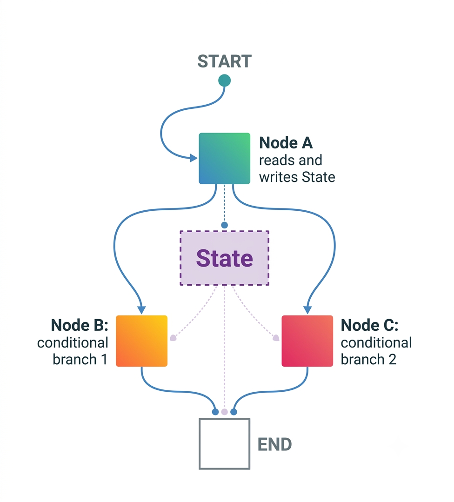
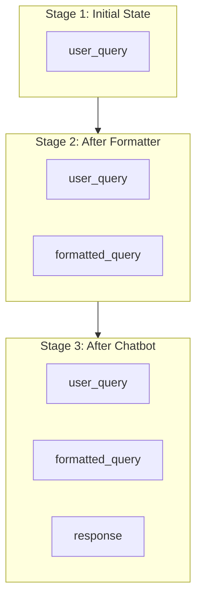

# LangGraph Basics

- **Graph:** The entire workflow, combining all nodes and edges.
- **Node:** A single task or agent; one unit of work.
- **Edge:** A connection between nodes that defines what happens next.
- **State:** A shared data object passed through the entire graph.
- **Start:** The entry point where every graph execution begins.
- **End:** The terminal node where execution stops.



## The Problem with One Node

A single chatbot can handle simple tasks well, but enterprise AI systems often require multiple responsibilities at once, such as formatting, reasoning, and structured output.

> **Note:** One node cannot specialize. It tries to do everything at once and may not do any one thing well.

Instead, we can break the workflow into focused stages:

```text
Requirement Analysis → Planning → Development → Testing → ...
```

### Enterprise Workflow

Each node handles one specific responsibility.

```text
Start
  ↓
Input Formatter
  ↓
Chatbot
  ↓
Output Formatter
  ↓
End
```

Each node does one thing — and does it well. This is the foundation of **modular AI design**.

# The Shared Notebook = State

Nodes don't communicate with each other directly. Instead, they read from and write to a **shared state**, like a notebook that every node can access.

## State Evolution



conditionalrouting/dynamic routing
how does ai choose what path to take 